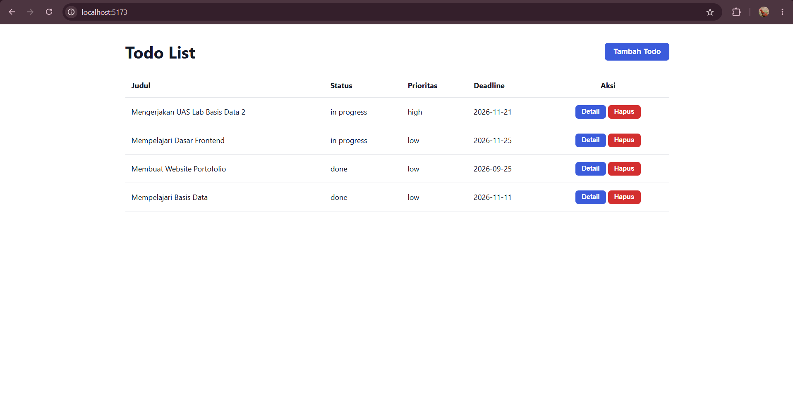
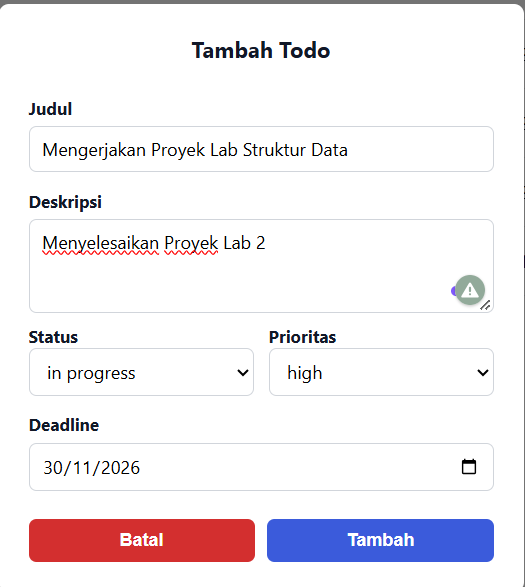
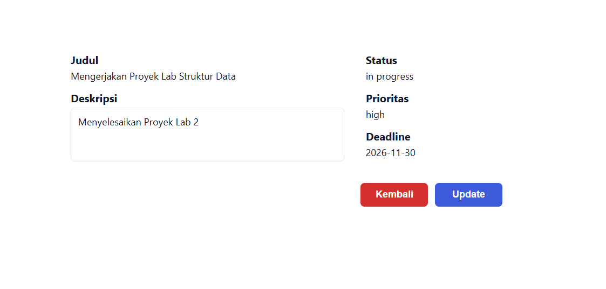
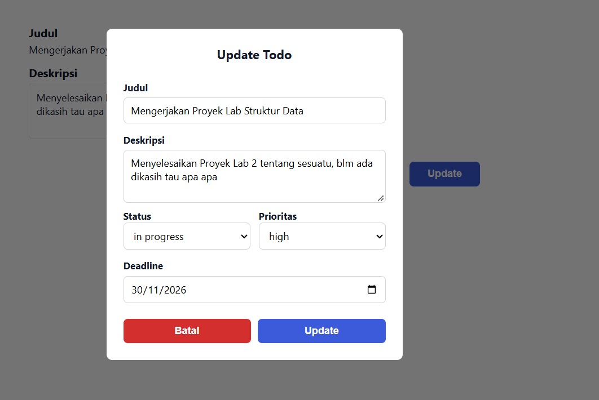
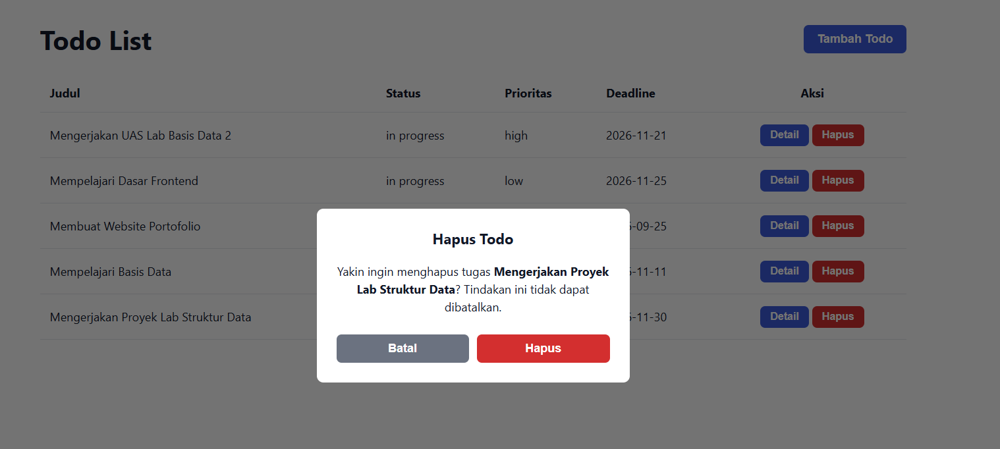

# Todo List - React.js

Kuis Praktikum: Pengembangan Frontend To-Do List dengan React.js.

## Fitur
- Menampilkan daftar tugas
- Melihat detail tugas
- Menambah tugas melalui formulir (modal)
- Memperbarui tugas
- Menghapus tugas (dengan konfirmasi dan notifikasi)
- Data dummy dikelola dengan React State (`useState`), tanpa memuat ulang halaman

## Struktur Data Tugas
`id`, `title`, `description`, `priority`, `deadline`, `status`

## Cara Menjalankan
```bash
npm install
npm run dev
```
Buka alamat yang tampil di terminal (biasanya http://localhost:5173).

## Screenshot
Tambahkan screenshot hasil aplikasi di sini (simpan gambar di folder `screenshots/`):

### Halaman Daftar Todo


### Tambah Todo


### Detail Todo


### Update Todo


### Konfirmasi Hapus

